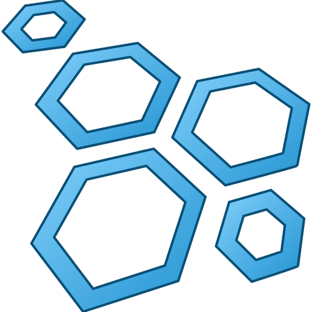

# rossat-swarm

 [](https://aur.archlinux.org/packages/rossat-swarm-git) [](https://aur.archlinux.org/packages/rossat-swarm-bin)


<p align="center"></p>

An open, Linux-native re-implementation of **ROCCAT Swarm** written in C++ with
GTK3. The protocol was recovered by decompiling ROCCAT Swarm 1.9482 and the
device module Swarm downloads for the mouse.

Currently supported: **ROCCAT Kone AIMO Remastered** (`1e7d:2e2c`).
See [MODULES.md](MODULES.md) for every device module Swarm can download and
which of them are supported here.

It ships three things:

| Part | Binary / file | Use it for |
|---|---|---|
| GUI | `rossat-swarm` | Swarm-style window: settings, button assignment, illumination, advanced settings, 5 profiles |
| CLI | `rossat-cli` | scripting and quick changes from a terminal |
| Library | `librossat.so` + `include/rossat/rossat.h` | building your own tools in C or C++ |

## Features (Kone AIMO Remastered)

- Read/switch the active profile (5 on-board profiles)
- DPI switcher: 5 levels, 100–16000 DPI in steps of 50, separate X/Y, enable mask, active level
- Polling rate 125/250/500/1000 Hz, angle snapping, debounce time
- Button assignment for all 12 buttons plus the Easy-Shift[+] layer, including shortcuts, text macros
  and **brightness step up/down** buttons (10 logarithmic steps, handled by the lighting engine)
- Lighting: effect, speed, brightness, colour and on/off for each of the 11 LEDs, AIMO colour themes
- Lighting engine for the effects the firmware can't draw itself – **AIMO**, **Heartbeat**,
  Breathing 2.0, Heartbeat 2.0 – reacting to mouse activity like Swarm's AIMO engine
- **Easy-Shift[+] lighting**: your own colour (solid or pulsing) while Easy-Shift is held –
  the mouse's built-in light blue is hard-coded in its firmware, so rossat draws it from the PC
- Any effect can be "rendered by the rossat engine", with a properly neutral white
  (the RGB+amber LEDs make the firmware's white look mint)
- Sensor (TDCU) calibration for your mousepad
- Backup / restore of all five profiles
- Raw report access for everything not decoded yet

Protocol details: [docs/PROTOCOL.md](docs/PROTOCOL.md).

## Installing

### Arch Linux (AUR)

Two packages are maintained in [`aur/`](aur):

| Package | Source |
|---|---|
| `rossat-swarm-bin` | prebuilt x86_64 tarball from the GitHub release |
| `rossat-swarm-git` | builds the latest commit from this repository |

```sh
yay -S rossat-swarm-bin      # or rossat-swarm-git
```

Both pull in `hidapi`, `gtk3` and `libayatana-appindicator` and install the udev
rule, the desktop entry, the icon and the `rossat-engine` user service.

### Release tarball

Every tag is built by [`.github/workflows/release.yml`](.github/workflows/release.yml)
(Arch Linux container) and attached to the GitHub release as
`rossat-swarm-<tag>-x86_64.tar.gz`, laid out for `/usr`:

```sh
sudo tar -xzf rossat-swarm-1.0.1-x86_64.tar.gz -C /
sudo udevadm control --reload && sudo udevadm trigger
```

Runtime dependencies: `hidapi`, `gtk3`, `libayatana-appindicator`.

## Building

Dependencies: CMake ≥ 3.16, a C++17 compiler, `hidapi` (hidraw backend, ≥ 0.14),
GTK 3 and `glib-compile-resources`; optional `libayatana-appindicator3` for the tray.

```sh
# Arch:   pacman -S cmake hidapi gtk3 libayatana-appindicator
# Debian: apt install cmake libhidapi-dev libgtk-3-dev libayatana-appindicator3-dev
cmake -S . -B build
cmake --build build
sudo cmake --install build      # optional
```

Options: `-DROSSAT_BUILD_GUI=OFF`, `-DROSSAT_BUILD_CLI=OFF`, `-DROSSAT_BUILD_TESTS=OFF`.
`ctest --test-dir build` runs the offline codec tests (no mouse needed).

### Device permissions

The mouse is accessed through `/dev/hidraw*`. Install the udev rule so your user
can open it without root:

```sh
sudo cp data/70-rossat.rules /etc/udev/rules.d/
sudo udevadm control --reload && sudo udevadm trigger
```

(`cmake --install` puts it in `<prefix>/lib/udev/rules.d`.)

## CLI

```sh
rossat-cli list                         # find the mouse
rossat-cli info                         # firmware + active profile
rossat-cli profile 2                    # switch to profile 2
rossat-cli show -p 1                    # dump profile 1 settings
rossat-cli set dpi1=800 dpi2=1600x1200 dpi-active=2 polling=1000
rossat-cli set effect=fully-lit brightness=200 led=all:#65c3f7 led=wheel:#ff0000
rossat-cli buttons                      # button assignment of the active profile
rossat-cli bind 9 shortcut ctrl+c       # thumb backward -> Ctrl+C
rossat-cli bind shift+11 volume-up
rossat-cli bind 8 brightness-up         # thumb forward: brightness step up (engine)
rossat-cli macro -b 8 --text "gg wp"    # store a text macro on thumb forward
rossat-cli set effect=aimo theme=3       # AIMO uses theme colours, not per-LED colours
rossat-cli set effect=breathing render=engine
rossat-cli shift-light on '#ff0000' pulse  # Easy-Shift colour (engine-rendered profiles)
rossat-cli engine                       # draw AIMO / Heartbeat / *-2.0 effects (Ctrl+C stops)
rossat-cli calibrate                    # TDCU calibration for your surface
rossat-cli backup my.rswb               # all 5 profiles; `restore my.rswb` writes them back
rossat-cli direct '#00ff00'             # host-controlled colour, `direct off` to undo
rossat-cli dump                         # raw hex of the reports
```

`rossat-cli --help` lists every key; `rossat-cli types` lists button functions.
Profiles, DPI levels, buttons and LEDs are numbered from 1 on the command line.

## GUI and system tray

`rossat-swarm` opens the Swarm-style window (coloured by your GTK theme). The
Button Assignment page takes shortcuts as text (`ctrl+c`, `alt+f4`) and text
macros; the Illumination page has the effect list with the "Render with rossat
engine" option, AIMO themes and Easy-Shift[+] lighting; Advanced Settings has
angle snapping, debounce, sensor calibration and the raw settings report.

The footer selects the profile being edited (● marks the active one),
**ACTIVATE** makes it the mouse's active profile, and the **AUTO APPLY** switch
writes every change to the mouse automatically (debounced) instead of waiting
for **APPLY**. The pages scroll and the footer wraps, so the window works at
small sizes too.

While it is open – window or tray – the GUI runs the lighting engine itself,
so engine-rendered effects, Easy-Shift[+] lighting and the brightness buttons
just work.

Under **Settings → Application**:

- **Keep running in the system tray** – closing the window hides it to the tray
  (StatusNotifierItem, e.g. waybar, KDE, GNOME with the AppIndicator extension).
  The tray menu shows/hides the window and quits.
- **Start minimized to the tray** – only available when the tray is enabled;
  starts without a window.

`rossat-swarm --minimized` (or `-m`) starts hidden in the tray for that run,
e.g. from your compositor's autostart (`exec-once = rossat-swarm --minimized`
on Hyprland); the lighting engine keeps running in the tray. Preferences live in
`~/.config/rossat/gui.ini`. Tray support needs `libayatana-appindicator3` at
build time (optional).

## Lighting engine

The mouse firmware renders Off, Fully lit, Blinking, Breathing, Snake and
Colorwave itself. **AIMO, Heartbeat, Breathing 2.0 and Heartbeat 2.0 are drawn
by the PC** (exactly like Swarm does), as are profiles set to "Render with
rossat engine", Easy-Shift[+] lighting and the brightness step buttons. One of
these has to run:

- `rossat-swarm` (window or tray, e.g. `rossat-swarm --minimized` in autostart), or
- `rossat-cli engine` in a terminal, or
- the user service, to have it always on without the GUI:

  ```sh
  systemctl --user enable --now rossat-engine.service   # installed by the packages / cmake --install
  ```

Only one engine runs at a time; the GUI shows when the service already owns it.
The engine follows the active profile, so switching profiles on the mouse
switches effects too, re-takes the LEDs whenever a profile write hands them back
to the firmware, and returns them to the firmware when it stops.

## Library

```c
#include <rossat/rossat.h>

rossat_device *dev;
if (rossat_open(NULL, &dev) == ROSSAT_OK) {
    rossat_settings s;
    rossat_read_settings(dev, 0, &s);      /* profile 1 */
    s.dpi_x[0] = s.dpi_y[0] = 1200;
    s.leds[ROSSAT_LED_WHEEL] = (rossat_color){255, 255, 0, 0};
    rossat_write_settings(dev, &s);        /* unknown bytes are preserved */
    rossat_close(dev);
}
rossat_exit();
```

Link with `pkg-config --cflags --libs rossat` or, from CMake,
`find_package(rossat)` + `target_link_libraries(app rossat::rossat)`.
Every call returns `ROSSAT_OK` or a negative `rossat_error`; `rossat_strerror()`
turns it into text.

## Status and caveats

- The read/write sequences, checksums and data layouts come straight from the
  decompiled Swarm code and were tested on a Kone AIMO Remastered (firmware
  1.05): profiles, settings, buttons, LED map, effects, direct lighting, the
  engine and calibration. Swarm's "sensitivity" is the Windows pointer speed,
  not a mouse setting, so rossat leaves it to your desktop.
- Writes always start from the bytes last read from the mouse, so fields this
  project does not understand are written back unchanged.
- Firmware updates are not implemented. The AIMO animation is rossat's own
  take on Swarm's (same themes, LED groups and activity reaction), not a
  byte-exact copy of `aimo.dll`.
- This project is not affiliated with ROCCAT or Turtle Beach. No ROCCAT code
  or artwork is included; the Swarm layout is recreated in GTK and coloured by
  your GTK theme, and the icon is an original drawing.

## License

[GPL-3.0-only](LICENSE).

## Repository layout

```
include/rossat/rossat.h   public C API
src/lib/                  protocol + HID transport (hidapi)
src/cli/                  rossat-cli
src/gui/                  rossat-swarm (GTK3)
data/                     icon, CSS, udev rule, desktop file, user service, pkg-config template
docs/PROTOCOL.md          reverse-engineered protocol and firmware notes
tools/re/                 scripts used for the reverse engineering
tests/                    offline codec tests (no device needed)
aur/                      PKGBUILDs: rossat-swarm-bin, rossat-swarm-git
.github/workflows/        release build (x86_64 tarball per tag)
MODULES.md                all Swarm device modules, with support checkboxes
icon.svg                  icon source drawing (data/rossat-swarm.svg adds the accent colours)
```
